# How history is synced between machines

**English** · [Tiếng Việt](SYNC-DIAGRAM.vi.md)

This document shows how claude-sync syncs Claude Code history (sessions) between several machines, using **4 machines** as the example:

| Name used here | Kind | Note |
|---|---|---|
| **Win-Office** | Windows (Git Bash) | the machine at the office |
| **Win-Home** | Windows (Git Bash) | the machine at home |
| **WSL-Office** | WSL Ubuntu | on the same physical PC as Win-Office but **a separate machine** (its own `~/.claude`, its own `machine_id`) |
| **WSL-Home** | WSL Ubuntu | on the same physical PC as Win-Home, also a separate machine |

Source: `lib/engine.sh` (`cs_run_cycle`, `cs_eng_pick`, `cs_eng_install`, `cs_eng_publish`, `cs_fork_resolve`).
The core idea: there is **no central server** and **no machine is the "main" one**. Each machine writes only to its own area on Google Drive and reads the areas of the other machines.

---

## 1. The big picture

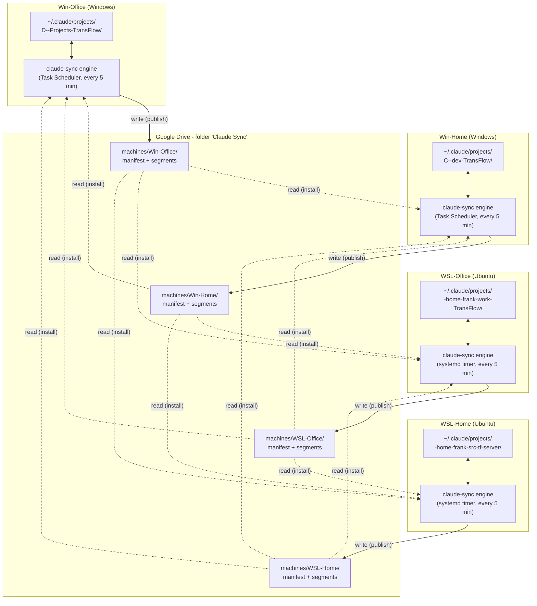

Key points:

- **Each machine writes only to `machines/<its own machine_id>/`**, so two machines never overwrite each other on Drive.
- The same project can live at a **different path, even under a different folder name**, on each machine (for example `TransFlow` and `tf-server`). You map it once with `claude-sync projects map`; after that claude-sync translates paths automatically (see §3).
- Each machine runs its own engine on a cycle. Whichever machine is on syncs by itself; the others do not need to be online.

---

## 2. Data layout on Drive

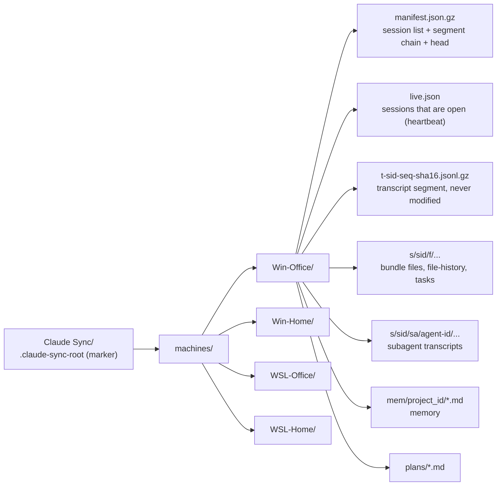

- The **manifest** is one machine's "table of contents": each session has a `head` (its current version), a list of `segs` (transcript pieces, each with `m` = the machine that owns it), `from` (the versions replaced when it was rewritten) and `forked`.
- A **segment** is an **appended** piece of transcript, with paths normalised, gzip-compressed and named after its hash, so it is never modified.
- Other machines only download the manifest (comparing `md5Checksum`, downloading only when it changed) and then fetch exactly the segments they are missing.

---

## 3. Translating paths between machines

A transcript `.jsonl` has fields that hold paths (`cwd`, `relocatedCwd`, `trackingPath`...). When **pushing**, this machine's paths are turned into neutral tokens; when **installing**, the tokens are turned into the receiving machine's paths.

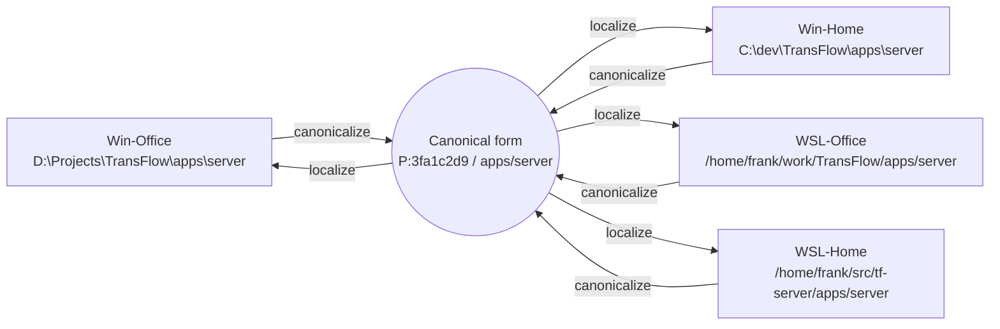

Each machine stores a session in the **slug folder of that machine's own path**, because `/resume` only lists sessions that sit in the slug folder of the directory Claude is started in:

| Machine | Project root | Slug folder in `~/.claude/projects/` |
|---|---|---|
| Win-Office | `D:\Projects\TransFlow` | `D--Projects-TransFlow` |
| Win-Home | `C:\dev\TransFlow` | `C--dev-TransFlow` |
| WSL-Office | `/home/frank/work/TransFlow` | `-home-frank-work-TransFlow` |
| WSL-Home | `/home/frank/src/tf-server` | `-home-frank-src-tf-server` |

---

## 4. One sync cycle on each machine

Each machine runs `claude-sync run` on a timer (5 minutes by default), at logon, on resume from sleep, or when the `SessionEnd` hook wakes it. The order is **pull first, push second**.

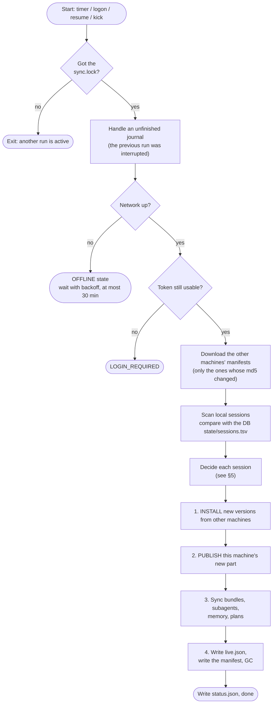

Soft deadline of 7 minutes: past it, no new work is started and the unfinished part is picked up on the next cycle.

---

## 5. The decision for each session

For each session the engine compares the local copy (`L`) with the version it already knows (`base`) and the versions other machines have published (the candidates).

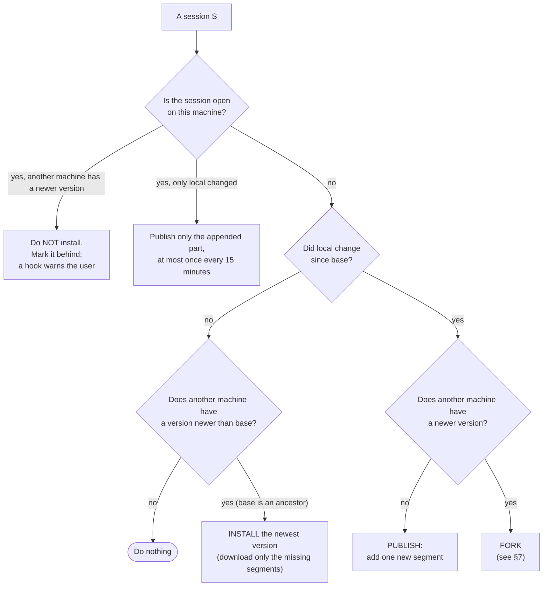

For a session that never had a `base` (a new machine, a lost DB), the engine compares the bytes of the local file with each candidate and picks `equal` (identical), `publish` (local is longer), `install` (local is the older copy) or `conflict` (unrelated, goes to the fork branch).

---

## 6. The normal case: 4 machines take turns on one session

Win-Office chats first, then WSL-Home continues, then Win-Home continues. Each "continue" produces **one new segment**; the new machine **references** the previous machine's segments instead of uploading them again.

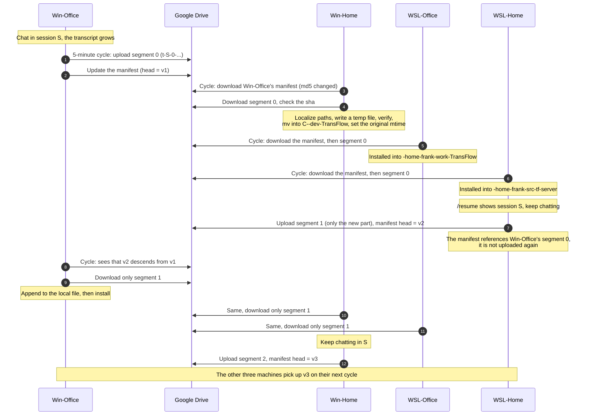

### A version is a chain of segments

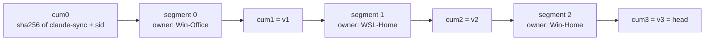

`version_id` is the cumulative hash of the segments up to that point. So the engine only has to check "is a in b's chain" to tell whether a version is an ancestor or a different branch, without comparing whole files.

---

## 7. Conflict: two machines continue one session while offline

Example: Win-Office and WSL-Home are both at version `v2`, both lose the network, and both keep chatting in session S.

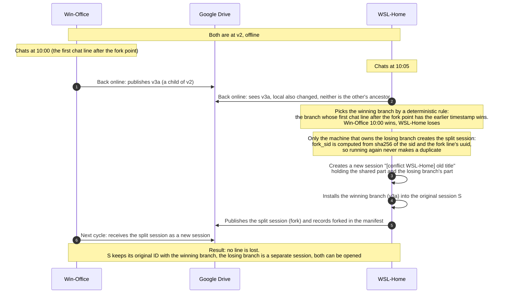

Detailed rules:

- The fork point is the first line where the two branches differ.
- If one branch's part after the fork point is **only metadata** (no chat lines), that branch loses quietly and **no** split session is made; a copy is kept in `backups/`. Merely **reopening** a session (the `SessionStart:resume` hook, the notice about an unfinished background task, `cost-state`...) also counts as metadata, so opening a session on a second machine does not create a `[conflict]`.
- The title of a split session is taken in this order: the name you gave with `/rename`, then the name Claude chose itself (`aiTitle`), then "(untitled)".
- On equal timestamps the smaller `machine_id` wins. Every machine computes the same result, so no machine has to coordinate.

---

## 8. A session that is open on the receiving machine

The engine **never replaces a transcript file under a running Claude** (this has been reproduced to lose lines).

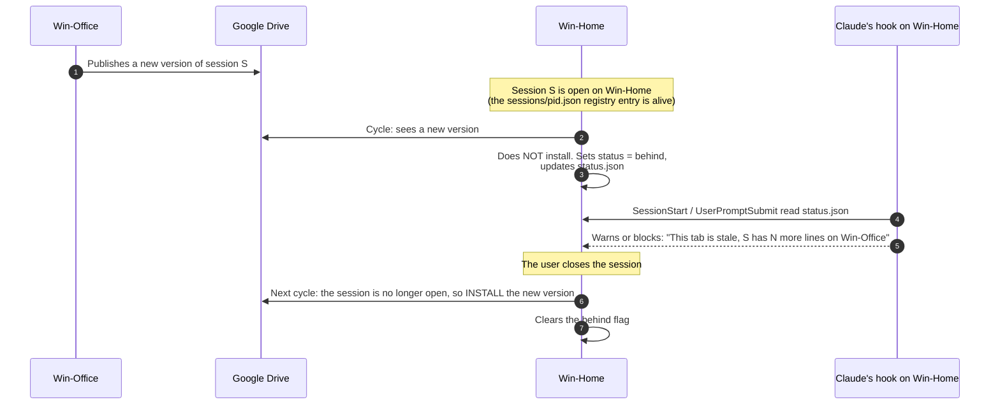

In addition, each machine's `live.json` says which sessions are open on that machine. Other machines read it to show "this session is open on Win-Office". Freshness is measured by Drive's server time, not by the machine clock.

---

## 9. The lifecycle of a session's state on one machine

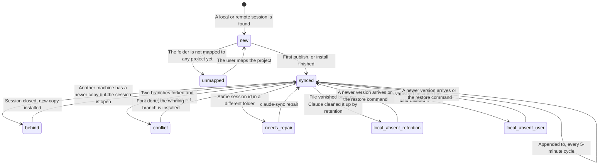

---

## 10. Special situations

### 10.1 A machine comes back after being off for a long time (catch-up sync)

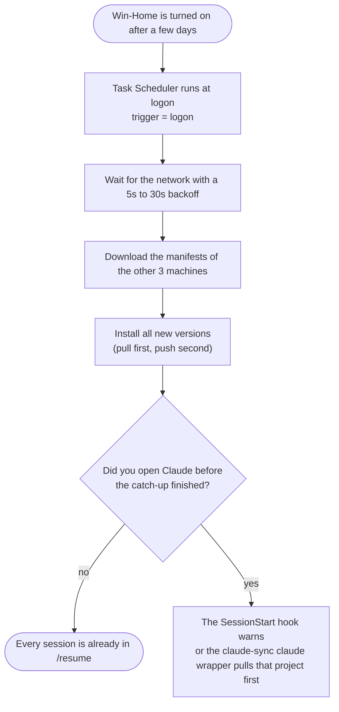

### 10.2 Deletion and retention (not propagated)

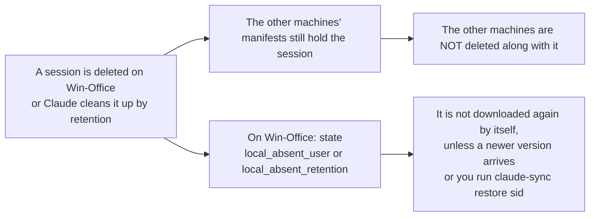

Conversely, a session whose `mtime` is older than the receiving machine's `cleanupPeriodDays` threshold is **not installed** (so Claude does not clean it up right away); it stays on Drive and can be installed with `restore`. Setup suggests `cleanupPeriodDays = 3650` on every machine.

### 10.3 A new folder, or a project that is not mapped on one machine

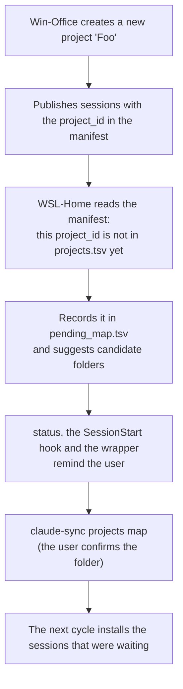

Candidate suggestions are ordered by confidence: an equivalent path (`D:\a\b` and `/mnt/d/a/b`), a local folder where Claude has already run, the same git remote (compared by hash, the URL is not uploaded), and only then a similar folder name. It is never mapped automatically, except in `all` mode when it meets a completely new local folder.

---

## 11. Summary of the invariants

| Invariant | Mechanism |
|---|---|
| No transcript line is lost | Segments are immutable; a conflict forks, it never overwrites |
| No two machines write to the same place | Each machine writes only to its own `machines/<id>/` |
| No overwriting an open session | Check the registry before installing, and compare-and-swap right before `mv` |
| Safe file install | Write a temp file, check the line count and that there is no CR, then `mv -f` |
| Each session ID is exactly one file per machine | Duplicate check across all `projects/*/`; a duplicate becomes `needs_repair` |
| Running again makes no duplicate | Drive file IDs are allocated up front and journaled; `fork_sid` is deterministic |
| Resume works correctly on another machine | Path translation + the right slug folder + the original `mtime` kept |

Limits of v1: two machines chatting at the same time in the same session in real time is not supported (if it happens the result is a fork as in §7), there is no end-to-end encryption, and settings/skills/CLAUDE.md are not synced.
