# Sơ đồ đồng bộ history giữa các máy

[English](SYNC-DIAGRAM.md) · **Tiếng Việt**

Tài liệu minh hoạ cách claude-sync đồng bộ history (session) của Claude Code giữa nhiều máy, với ví dụ **4 máy**:

| Tên trong tài liệu | Loại | Ghi chú |
|---|---|---|
| **Win-Office** | Windows (Git Bash) | máy ở công ty |
| **Win-Home** | Windows (Git Bash) | máy ở nhà |
| **WSL-Office** | WSL Ubuntu | trên cùng máy vật lý với Win-Office nhưng **là một máy riêng** (có `~/.claude` riêng, `machine_id` riêng) |
| **WSL-Home** | WSL Ubuntu | trên cùng máy vật lý với Win-Home, cũng là một máy riêng |

Nguồn: `lib/engine.sh` (`cs_run_cycle`, `cs_eng_pick`, `cs_eng_install`, `cs_eng_publish`, `cs_fork_resolve`).
Khái niệm cốt lõi: **không có máy chủ trung tâm** và **không có máy nào là "chính"**. Mỗi máy chỉ ghi vào vùng riêng của mình trên Google Drive, và đọc vùng của các máy khác.

---

## 1. Bức tranh tổng thể

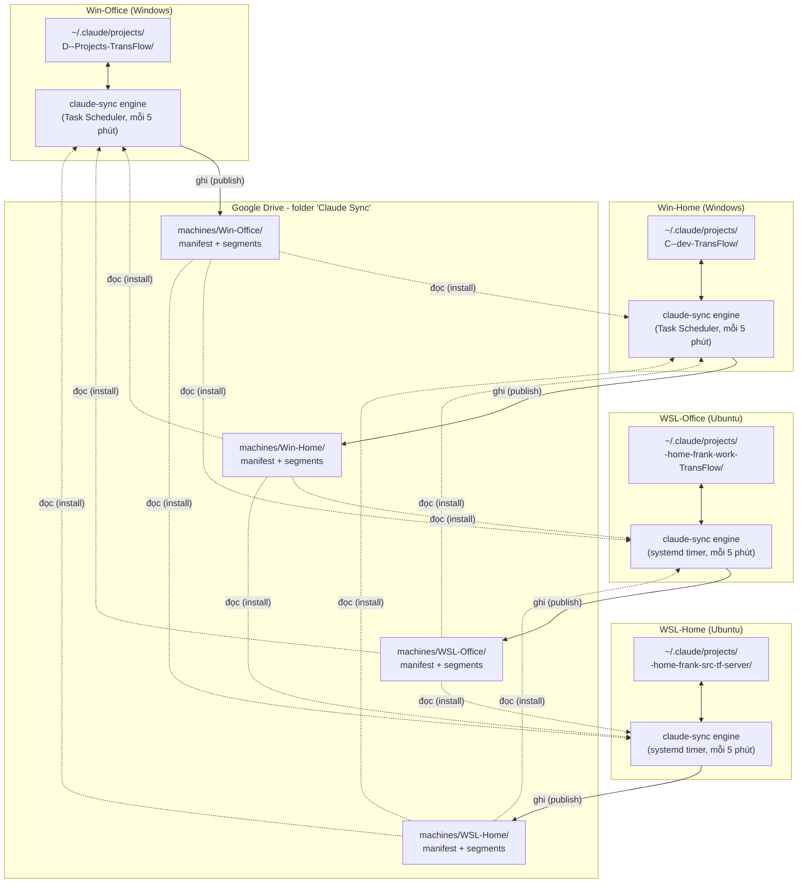

Ý chính:

- **Mỗi máy chỉ ghi vào `machines/<machine_id của mình>/`**, nên không bao giờ hai máy ghi đè lên nhau trên Drive.
- Cùng một project có thể nằm ở **path khác nhau, thậm chí tên thư mục khác nhau** trên mỗi máy (ví dụ `TransFlow` và `tf-server`). Người dùng map một lần bằng `claude-sync projects map`; sau đó claude-sync dịch path tự động (xem §3).
- Mỗi máy có engine chạy độc lập theo chu kỳ. Máy nào bật thì máy đó tự sync, không cần các máy còn lại cùng online.

---

## 2. Cấu trúc dữ liệu trên Drive

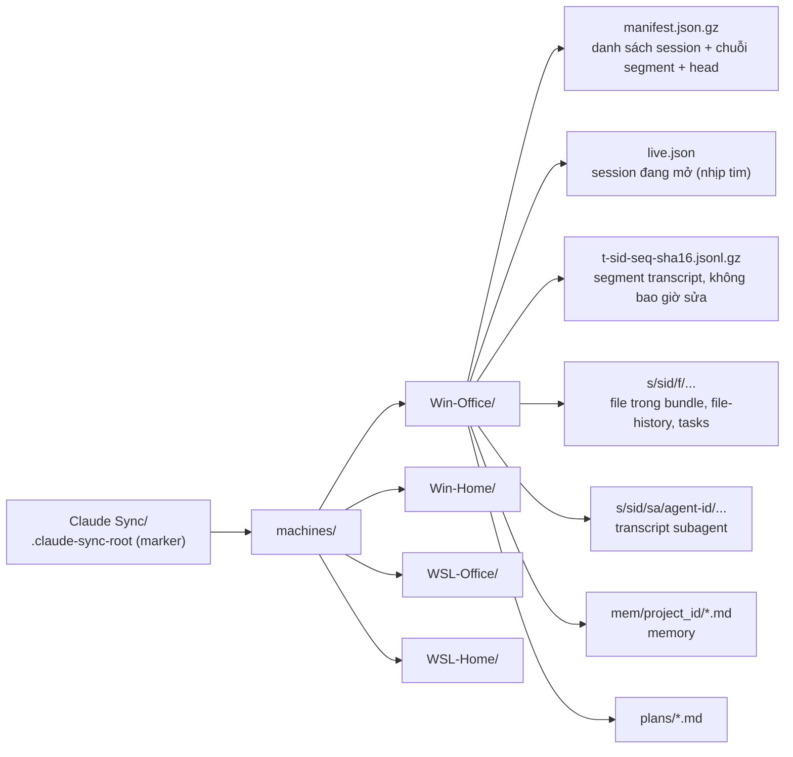

- **manifest** là "mục lục" của một máy: mỗi session có `head` (version hiện tại), danh sách `segs` (các đoạn transcript, mỗi đoạn có `m` = máy sở hữu), `from` (các version bị thay thế khi viết lại), `forked`.
- **Segment** là phần transcript **nối thêm**, đã chuẩn hoá path, nén gzip, đặt tên theo hash nên không bao giờ bị sửa.
- Các máy khác chỉ cần tải manifest (so `md5Checksum`, chỉ tải khi đổi) rồi tải đúng những segment còn thiếu.

---

## 3. Dịch path giữa các máy

Transcript `.jsonl` có các field chứa path (`cwd`, `relocatedCwd`, `trackingPath`...). Khi **đẩy lên**, path của máy mình được đổi thành token trung lập; khi **cài về**, token được đổi thành path của máy nhận.

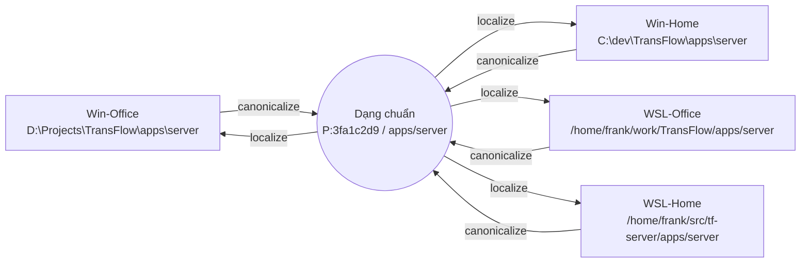

Mỗi máy lưu session vào **thư mục slug của chính path máy đó**, vì `/resume` chỉ liệt kê session nằm đúng thư mục slug của thư mục đang chạy Claude:

| Máy | Root của project | Thư mục slug trong `~/.claude/projects/` |
|---|---|---|
| Win-Office | `D:\Projects\TransFlow` | `D--Projects-TransFlow` |
| Win-Home | `C:\dev\TransFlow` | `C--dev-TransFlow` |
| WSL-Office | `/home/frank/work/TransFlow` | `-home-frank-work-TransFlow` |
| WSL-Home | `/home/frank/src/tf-server` | `-home-frank-src-tf-server` |

---

## 4. Một chu kỳ sync trên mỗi máy

Mỗi máy chạy `claude-sync run` theo timer (mặc định 5 phút), khi đăng nhập, khi resume từ sleep, hoặc khi hook `SessionEnd` đánh thức. Thứ tự **pull trước, push sau**.

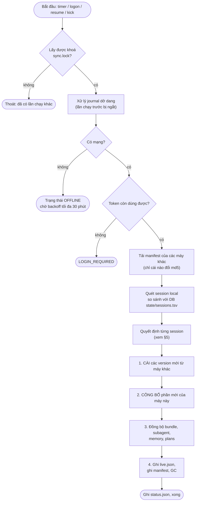

Hạn mềm 7 phút: quá hạn thì không bắt đầu việc mới, phần dở được làm tiếp ở chu kỳ sau.

---

## 5. Quyết định cho từng session

Với mỗi session, engine so sánh bản local (`L`) với version đã biết (`base`) và các version mà máy khác công bố (ứng viên).

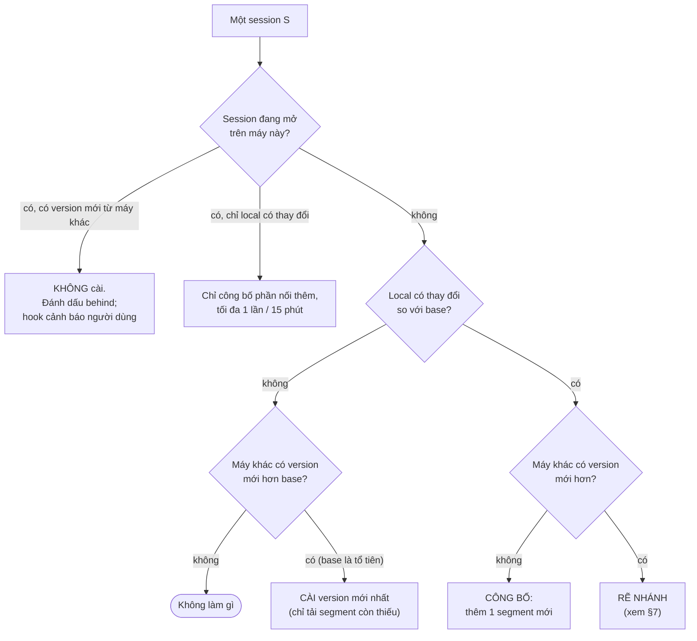

Trường hợp session chưa từng có `base` (máy mới, DB bị mất): engine so byte của file local với từng ứng viên để chọn `equal` (giống hệt), `publish` (local dài hơn), `install` (local là bản cũ), hoặc `conflict` (không liên quan, sang nhánh fork).

---

## 6. Kịch bản bình thường: 4 máy nối tiếp nhau trên một session

Win-Office chat trước, sau đó chuyển sang WSL-Home viết tiếp, rồi Win-Home viết tiếp. Mỗi lần "viết tiếp" chỉ sinh **một segment mới**; máy mới **tham chiếu** segment của máy trước, không upload lại.

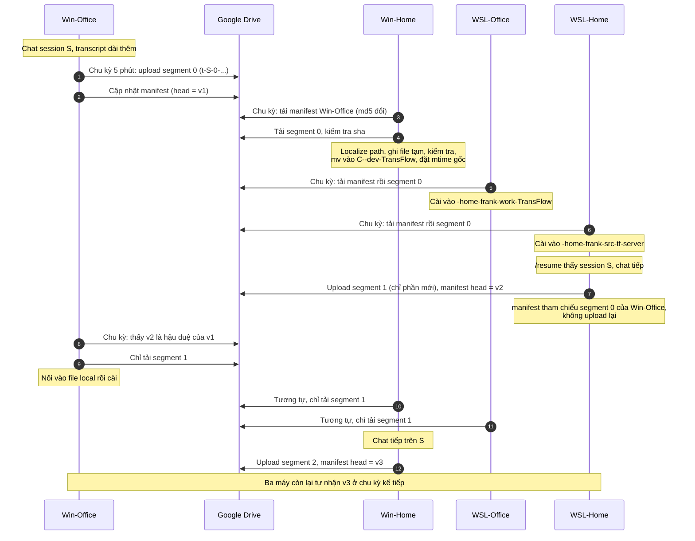

### Version là một chuỗi segment

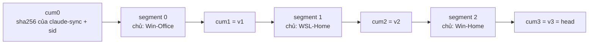

`version_id` = hash cộng dồn của các segment đến đó. Nhờ vậy engine chỉ cần kiểm tra "a có nằm trong chuỗi của b không" để biết một version là tổ tiên hay nhánh khác, mà không phải so cả file.

---

## 7. Xung đột: hai máy cùng viết tiếp một session khi offline

Ví dụ: Win-Office và WSL-Home cùng ở version `v2`, cùng bị mất mạng, cùng chat tiếp session S.

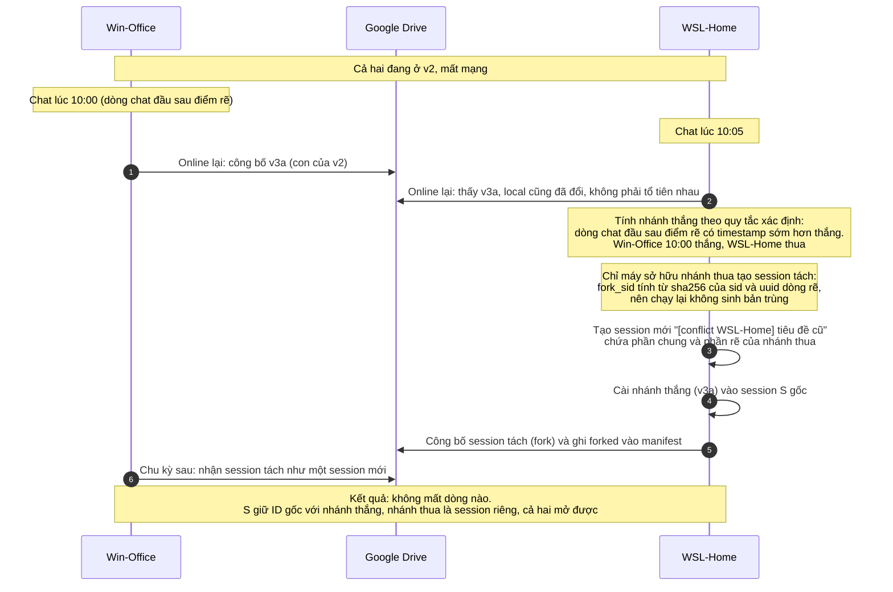

Quy tắc chi tiết:

- Điểm rẽ = dòng đầu tiên mà hai nhánh khác nhau.
- Nếu phần rẽ của một nhánh **chỉ toàn metadata** (không có dòng chat) thì nhánh đó thua âm thầm, **không** sinh session tách; bản sao được lưu vào `backups/`. Chỉ **mở lại** một session (hook `SessionStart:resume`, thông báo task nền chưa xong, `cost-state`...) cũng tính là metadata, nên mở xem session ở máy thứ hai không tạo ra `[conflict]`.
- Tiêu đề của session tách lấy theo thứ tự: tên bạn đặt bằng `/rename`, rồi tên Claude tự đặt (`aiTitle`), rồi "(untitled)".
- Bằng nhau về timestamp thì chọn `machine_id` nhỏ hơn. Mọi máy tính ra cùng kết quả, không cần máy nào điều phối.

---

## 8. Session đang mở trên máy nhận

Engine **không bao giờ thay file transcript dưới chân một Claude đang chạy** (đã tái hiện là làm mất dòng).

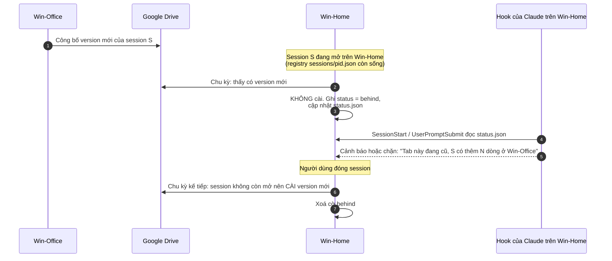

Ngoài ra `live.json` của mỗi máy cho biết session nào đang mở ở máy đó. Máy khác đọc để hiện "session này đang mở ở Win-Office". Độ mới tính theo giờ server của Drive, không dùng đồng hồ máy.

---

## 9. Vòng đời trạng thái của một session trên một máy

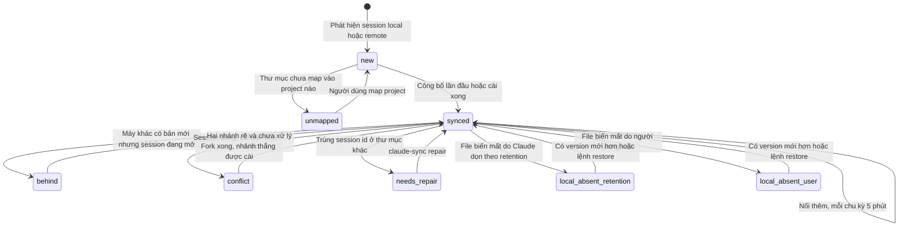

---

## 10. Các tình huống đặc biệt

### 10.1 Máy bật lại sau khi tắt lâu (sync bù)

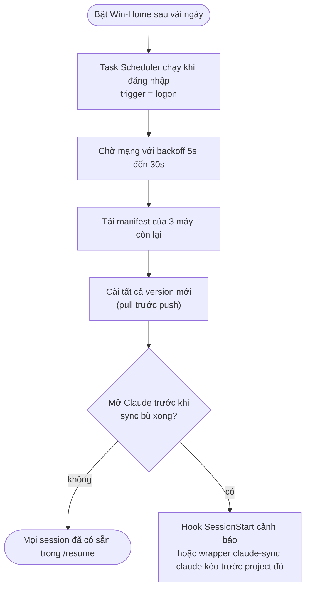

### 10.2 Xoá và retention (không lan truyền)

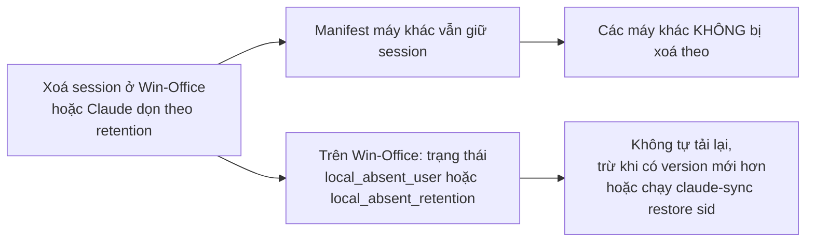

Ngược lại, session có `mtime` cũ hơn ngưỡng `cleanupPeriodDays` của máy nhận sẽ **không được cài** (tránh bị Claude dọn ngay); nó vẫn nằm trên Drive và cài được bằng `restore`. Setup đề nghị đặt `cleanupPeriodDays = 3650` trên mọi máy.

### 10.3 Thư mục mới hoặc project chưa map trên một máy

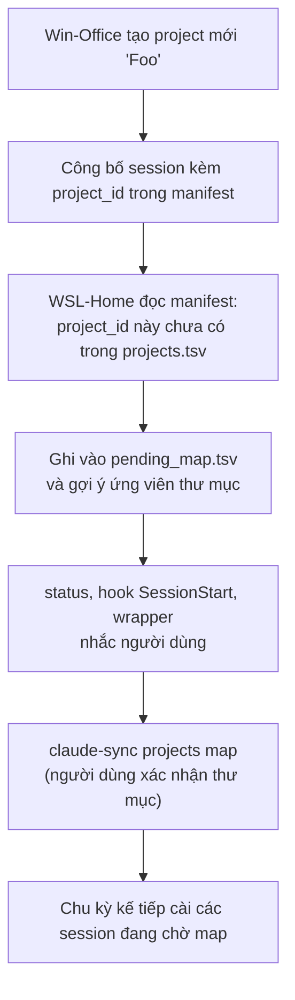

Gợi ý ứng viên xếp theo độ tin cậy: path tương đương (`D:\a\b` và `/mnt/d/a/b`), thư mục Claude local đã từng chạy, cùng git remote (so mã băm, không upload URL), rồi mới đến tên thư mục gần giống. Không bao giờ tự map, trừ trường hợp chế độ `all` gặp thư mục local hoàn toàn mới.

---

## 11. Tóm tắt các bất biến

| Bất biến | Cơ chế |
|---|---|
| Không mất dòng transcript nào | Segment bất biến; xung đột thì fork, không ghi đè |
| Không hai máy ghi cùng một chỗ | Mỗi máy chỉ ghi `machines/<id>/` của mình |
| Không đè lên session đang mở | Kiểm tra registry trước khi cài và so-và-đổi (compare-and-swap) ngay trước `mv` |
| Cài file an toàn | Ghi file tạm, kiểm số dòng và không có CR, rồi `mv -f` |
| Mỗi session ID đúng một file trên mỗi máy | Kiểm tra trùng trên toàn bộ `projects/*/`; trùng thì `needs_repair` |
| Chạy lại không sinh bản trùng | ID file Drive cấp trước và ghi journal; `fork_sid` tính xác định |
| Resume đúng ở máy khác | Dịch path + đặt vào đúng thư mục slug + giữ `mtime` gốc |

Giới hạn của v1: không hỗ trợ hai máy chat cùng lúc trong cùng một session theo thời gian thực (nếu xảy ra thì kết quả là fork như §7), không mã hoá đầu-cuối, không sync settings/skills/CLAUDE.md.
